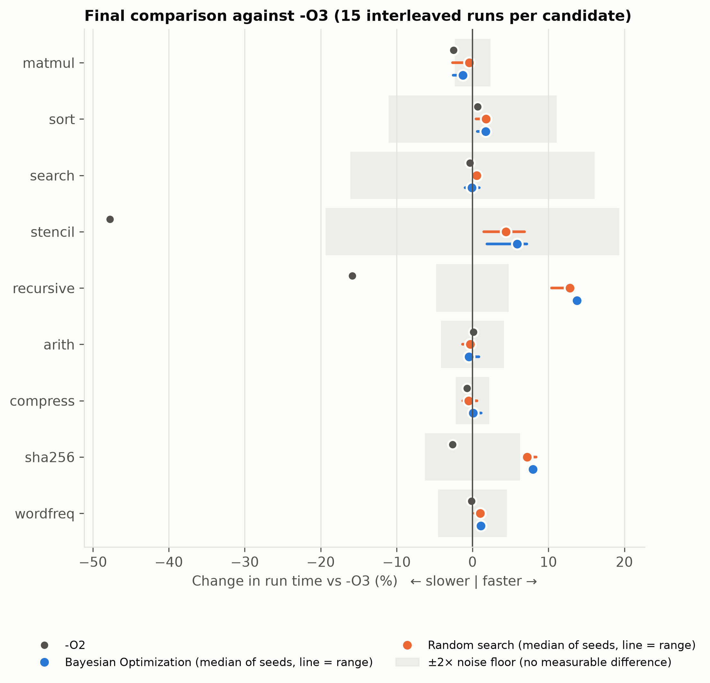
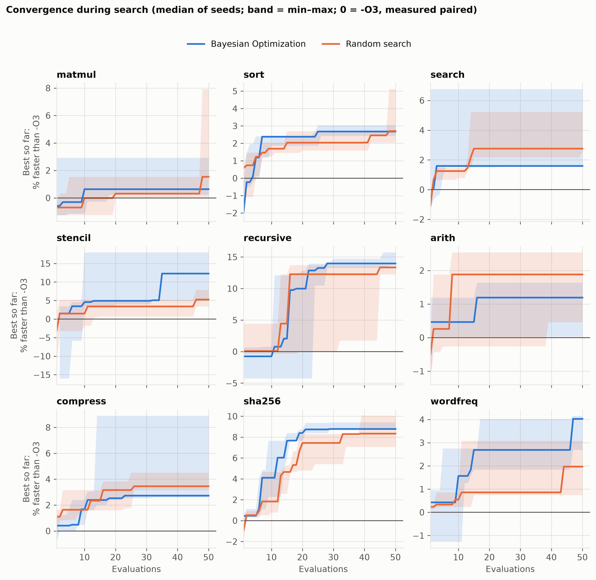
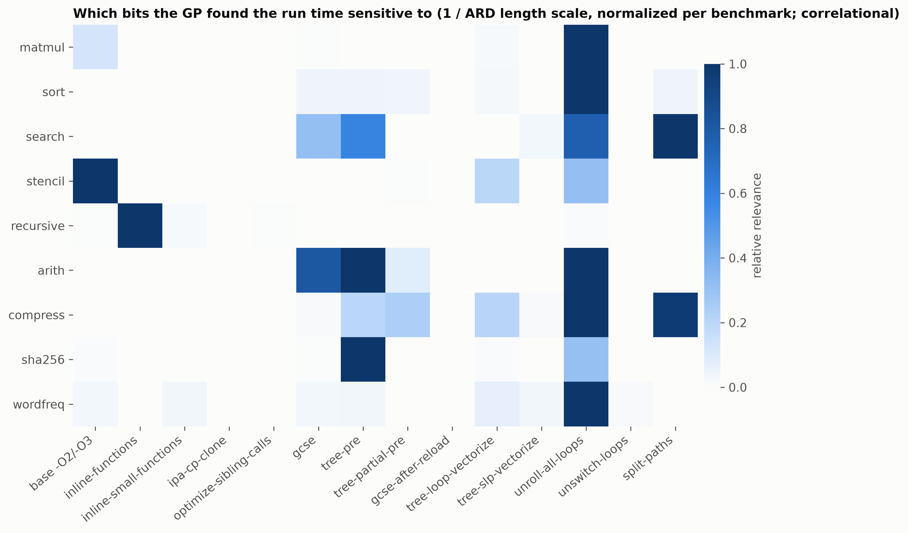
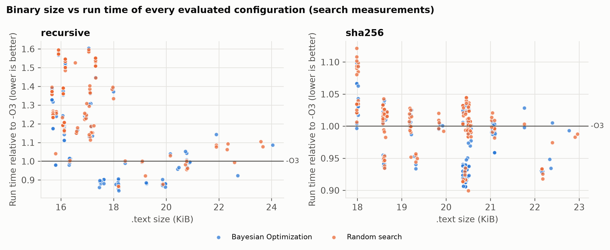

# Automatic Selection of Compiler Optimization Passes Using Bayesian Optimization

*Compiler Lab project report · Team 12 · School of Computer Science and Engineering (SCOPE), Vellore Institute of Technology*

| Member | Name | Reg. no. | Role |
| --- | --- | --- | --- |
| 1 | Aditya Agarwal | 24BCE0587 | compiler and correctness |
| 2 | Priyanshu Krishna Srivastava | 24BCE2464 | benchmarks and measurement |
| 3 | Kumar Paritosh | 24BCE2863 | Bayesian Optimization |
| 4 | Maddulapalli Venkata Satya Abhinav Sarma | 24BAI0125 | integration, experiments and website |

*The conference-style paper is in `docs/manuscript/`; this report adds implementation detail.*

## Abstract

Compilers ship a few fixed optimization recipes, but the best set of passes depends on the program. We present a system that selects GCC 16 optimization flags per program with Bayesian Optimization (BO): a Gaussian-process surrogate with Expected Improvement proposes a configuration, which is compiled, checked for correct output and timed against `-O3` in alternating A-B/B-A rounds that cancel machine-speed drift. A verified, side-effect-aware encoding guarantees that the `-O3` vector reproduces `-O3` byte for byte, and binary-hash deduplication avoided re-timing 43% of evaluations. Over 9 programs (6 kernels and 3 real-world workloads on a 3.5 MB corpus of real text), 2 methods, 3 seeds and 50 evaluations each (2,700 evaluations), every best configuration was re-measured in 15 interleaved rounds. BO found statistically significant speed-ups over `-O3` on `recursive` (×1.157–×1.166, all seeds) and on the real-data `sha256` (×1.080–×1.092), and the gains held on 2× larger inputs (×1.29 and ×1.09). The other programs showed no measurable difference: `-O3` is already near-optimal for them. The geometric-mean speed-up was ×1.035 for BO and ×1.033 for random search. BO reached good configurations sooner, leading random search after 10 evaluations on 7 of 9 programs, but at 50 evaluations in this 14-bit space random search caught up.

## 1. Introduction

Compilers expose dozens of optimization passes, but most programs are built with
one of a handful of fixed levels (`-O1`, `-O2`, `-O3`). These levels are tuned
for "typical" code; a particular program may run faster with a different set of
passes. Finding that set by trial is expensive: every candidate must be compiled,
run and timed, and the number of combinations grows as 2^n in the number of
passes.

Bayesian Optimization (BO) is designed for exactly this kind of expensive,
black-box search. It fits a probabilistic surrogate model to the measurements
taken so far and uses it to pick the next configuration most likely to improve.
This project builds a complete system around GCC that uses BO to select
optimization passes per program, and evaluates it against the standard levels
and against random search given the same evaluation budget.

**Research question.** Can Bayesian Optimization find GCC flag configurations
that run faster than `-O3` on our benchmarks, and does it find good
configurations with fewer evaluations than random search?

## 2. Background

**GCC optimization levels and flags.** `-O1`, `-O2` and `-O3` each enable a set
of passes, which are controlled individually by `-f<pass>` / `-fno-<pass>`
flags. `gcc -Q --help=optimizers <options>` prints the effective state of every
flag for a given command line, which this project uses to verify its encoding.
Individual flags have almost no effect at `-O0`, and GCC's internal pass *order*
is fixed, so this project searches pass **selection**, not ordering.

**Gaussian-process regression.** A Gaussian process (GP) models an unknown
function as a distribution over functions. Given observations, it predicts a
mean mu(x) and an uncertainty sigma(x) at any new point. We use a Matérn 5/2
kernel with one length scale per input dimension (ARD), plus a white-noise term
for timing noise. A short fitted length scale means the objective is sensitive
to that flag.

**Expected Improvement.** With y* the best value observed so far, Expected
Improvement for minimization is
EI(x) = (y* - mu(x) - xi) Phi(Z) + sigma(x) phi(Z), where Z = (y* - mu(x) - xi) / sigma(x).
EI is large where the model predicts a low value (exploitation) or is uncertain
(exploration).

## 3. Design

### 3.1 Search space

A configuration is a binary vector: one bit selects the base level (`-O2`/`-O3`),
and one bit per flag selects whether that pass is on. Starting from 21 candidate
flags, `scripts/verify_flags.py` (i) confirmed each flag toggles in `gcc -Q`,
(ii) read each flag's real default at `-O2`/`-O3`, and (iii) screened each flag by
flipping it alone and checking whether any benchmark binary changed. 13 flags
changed at least one binary, so d = 14 bits and 16,384 configurations before
constraints. One dependency rule applies: `-ftree-partial-pre` has no effect
without `-ftree-pre`, so such vectors are canonicalized to one point.

Two findings from verification shaped the encoding. First, GCC 16 enables
`-funroll-loops` at `-O2`, unlike older manuals. Second, spelling some flags out
changes *other* flags: an explicit `-funroll-loops`, even at its default value,
also enables `-frename-registers` and `-fweb`. A flag is therefore passed only
when its bit differs from the base level's default. With this rule, the vectors
for `-O2` and `-O3` produce byte-identical executables to plain `-O2`/`-O3` on all
benchmarks (checked by SHA-256), which validates the encoding.

### 3.2 Objective

y(x) = ln( median over rounds r of  t_r(x) / t_r(-O3) ), minimized.

Each configuration's timed runs alternate with runs of an `-O3` build, in A-B
then B-A order, and y is the log of the median per-round time ratio. The log
ratio is unit-free and symmetric, and pairing cancels changes in machine speed.
Pairing was introduced after the first sweep showed `-O3` itself drifting from
228 ms to 308 ms within minutes (Section 8). Binary size and compile time are
recorded but not optimized, because combining seconds and bytes needs an
arbitrary exchange rate.

### 3.3 Optimizer

- **Initial design:** the `-O3` vector plus 7 random valid vectors (seeded), shared
  by BO and random search.
- **Surrogate:** scikit-learn `GaussianProcessRegressor`, ConstantKernel x
  Matern(nu=2.5, ARD) + WhiteKernel, `normalize_y`, refit after every observation.
- **Acquisition:** EI (xi = 0.01) maximized over a pool of 2,000 random valid
  unseen vectors plus all 1-bit neighbours of the 5 best so far.
- **Failures:** compile errors, crashes, timeouts and wrong outputs get
  y = (worst successful y) + 1 in the model, so the GP learns to avoid them.
- **Budget:** 50 evaluations per run; 3 seeds per benchmark and method.

### 3.4 Measurement

Benchmarks time only their kernel with a monotonic clock (`QueryPerformanceCounter`
/ `clock_gettime`) and print `CHECKSUM=` and `KERNEL_NS=`. During search, each
configuration gets 1 warm-up round plus 5 timed rounds, each round running the
configuration and the `-O3` reference once. A configuration is re-measured once
if the coefficient of variation of its per-round ratios exceeds 5%. Every output is checked against a
reference checksum from the `-O0` build. Executables with an identical SHA-256
are measured once.

## 4. Implementation

The system is a Python package (`bopass`) plus scripts, organized so that each
team member owns one area (see README). The optimizer exposes an ask/tell
interface, so it was developed and tested against a synthetic objective before
the compiler was attached. Results are appended to one CSV per run, with a JSON
manifest recording the compiler version, package versions, machine, seeds and
settings. Runs resume after interruption.

Engineering problems solved along the way (all on Windows/MinGW):

| Problem | Fix |
| --- | --- |
| PE timestamp made identical builds hash differently | `-Wl,--no-insert-timestamp` on every build |
| Executables and DLLs cannot load from paths > 260 characters | build directory falls back to a short temp path |
| Killing `gcc` on timeout left `cc1.exe` holding the pipes, hanging the harness | kill the whole process tree (`bopass/proc.py`) |
| Machine speed changed ~35% within minutes (power source) | paired A-B/B-A measurement against `-O3`; interleaved final measurement |

**Testing.** The pytest suite cover the encoding and constraints, the EI formula,
no-repeat and seed determinism of the optimizers, every evaluator status path
(with fakes), CSV storage including a truncated last line, the compiler driver
and runner against real failure programs (crash, infinite loop, syntax error,
bad output), and end-to-end runs (budget, resume, failure injection, in-run
reference). A synthetic test shows BO beats random search on average over 10
seeds before any compiler is involved.

## 5. Experimental setup

**Platform.** All measurements ran on one laptop with an Intel Core i7-12650H (6 performance + 4 efficiency cores, 16 threads), Windows 11, GCC 16.1.0 (MinGW-w64, UCRT) and Python 3.12 with scikit-learn 1.9. The default `-march` was used, and `-ffast-math`, `-Ofast` and `-march=native` were excluded because they change semantics or the target.

**Programs.** Table 1 lists the nine programs. The six kernels use fixed-seed generated inputs. The three real-world programs process a 3.5 MB corpus of real human-written text (442,020 words): the CPython changelog, its documentation and library source code, taken from the local Python installation and committed with its SHA-256. Every program prints a checksum, and every optimized build must reproduce the `-O0` checksum.

Table: TABLE 1. Programs and baseline run time (median kernel time, ms)
| Program | Kind | Kernel | -O0 | -O2 | -O3 |
| --- | --- | --- | --- | --- | --- |
| matmul | synthetic | 700×700 double matrix multiply | 1179 | 235 | 234 |
| sort | synthetic | quicksort, 3 × 10⁶ int32 | 414 | 245 | 248 |
| search | synthetic | 1.5 × 10⁶ binary searches | 445 | 328 | 332 |
| stencil | synthetic | 2-D Jacobi, 1024², 400 sweeps | 1832 | 335 | 225 |
| recursive | synthetic | N-Queens(12) + Fibonacci(35) | 286 | 135 | 117 |
| arith | synthetic | Mandelbrot 800×600, 1024 iterations | 705 | 325 | 325 |
| compress | real data | LZ77/LZSS compress + decompress | 536 | 328 | 331 |
| sha256 | real data | SHA-256 (FIPS 180-4), 15 rounds | 835 | 214 | 211 |
| wordfreq | real data | tokenize, count, rank all words | 517 | 247 | 247 |

**Protocol.** Each program was searched by BO and by random search with seeds 0, 1 and 2, giving 54 searches of 50 evaluations each (2,700 evaluations, 5.05 hours of active search time). Then each search's best configuration was rebuilt together with `-O0`…`-O3` and measured in one warm-up round and 15 interleaved rounds, each with a newly shuffled order (Step B). Every output was re-checked (Step C), and the same binaries were re-measured on an input about 2× larger (Step D). The noise floor of each program is the coefficient of variation of 30 runs of its `-O3` build.

**Statistics.** Speed-up is median t(`-O3`) / median t(config). Its 95% confidence interval is a percentile bootstrap (10,000 resamples) of the ratio of medians, and significance is a two-sided Mann–Whitney U test. We call a configuration *faster* or *slower* only if p < 0.05, the confidence interval excludes 1, **and** the difference exceeds twice the program's noise floor. Averages across programs are geometric means of speed-ups.

## 6. Results

### A. RQ1: Does BO beat -O3?

Table 2 and Fig. 1 summarize the final, interleaved re-measurement. BO's best configurations were significantly faster than `-O3` on two programs in every seed. On `recursive` the speed-up was ×1.157–×1.166 (95% CI of the best seed [1.141, 1.174], p = 3.4×10⁻⁶), i.e. 13.6–14.2% less run time. On the real-data `sha256` it was ×1.080–×1.092 (p = 3.4×10⁻⁶ in every seed). `stencil` improved by ×1.019–×1.077, but this memory-bound kernel has a 9.7% noise floor, so no seed met the verdict rule. On `matmul`, `search`, `arith`, `compress` and `wordfreq` the results stayed within ±1.5% of `-O3`. One `matmul` configuration (BO, seed 1) that looked 0.6% faster during search was in fact 2.5% *slower* when re-measured, a direct instance of the winner's curse. Across all nine programs, the geometric-mean speed-up was ×1.035 for BO and ×1.033 for random search. Over the 27 runs per method, the verdicts were 6 faster, 20 no measurable difference and 1 slower, identical for both methods.

Table: TABLE 2. Final speed-up vs -O3 (median of 3 seeds, range in brackets; 15 interleaved rounds)
| Program | BO | Random | BO seeds faster / tie / slower | On 2× input (BO) |
| --- | --- | --- | --- | --- |
| matmul | ×0.988 [0.975–0.992] | ×0.996 [0.974–0.999] | 0 / 2 / 1 | ×1.008 |
| sort | ×1.018 [1.006–1.020] | ×1.018 [1.005–1.019] | 0 / 3 / 0 | ×1.015 |
| search | ×0.999 [0.990–1.009] | ×1.005 [1.005–1.007] | 0 / 3 / 0 | ×0.997 |
| stencil | ×1.062 [1.019–1.077] | ×1.046 [1.015–1.074] | 0 / 3 / 0 | ×1.029 |
| recursive | **×1.160** [1.157–1.166] | ×1.147 [1.116–1.155] | 3 / 0 / 0 | **×1.291** |
| arith | ×0.995 [0.995–1.009] | ×0.997 [0.987–1.003] | 0 / 3 / 0 | ×0.987 |
| compress | ×1.001 [0.998–1.011] | ×0.995 [0.987–1.006] | 0 / 3 / 0 | ×1.002 |
| sha256 | **×1.086** [1.080–1.092] | ×1.078 [1.074–1.091] | 3 / 0 / 0 | **×1.087** |
| wordfreq | ×1.011 [1.005–1.012] | ×1.010 [1.003–1.013] | 0 / 3 / 0 | ×1.003 |
| geometric mean | ×1.035 | ×1.033 | 6 / 20 / 1 | |

### B. RQ2: Is BO more sample-efficient than random search?

Fig. 2 shows the best configuration found so far, as a function of the number of evaluations. BO led early. After 10 evaluations its median best was ahead of random search on 7 of 9 programs: on `sha256` +4.1% vs +1.8%, on `stencil` +4.6% vs +1.5%, on `wordfreq` +1.6% vs +0.5%. On `sha256` BO needed a median of 19 evaluations to come within 1% of its final best, against 34 for random search. By 50 evaluations the advantage had largely disappeared (median best +3.0% vs +3.4% across programs), and the verified final quality of the two methods was statistically indistinguishable. The space has 2¹⁴ points, yet only a few flags matter per program, so random search hits a good region within 50 draws often enough to catch up.

### C. RQ3: What did the search find?

The winning configurations are interpretable. On `recursive`, all six best configurations turned off `-foptimize-sibling-calls` and partial redundancy elimination, and five of six also turned off `-fipa-cp-clone` and `-fgcse-after-reload`. `-O3`'s function cloning inflates this call-heavy program's code (`.text` is 21,276 bytes at `-O3` vs 16,992 at `-O2`), and BO's configuration was both faster and 12–16% smaller than `-O3`. On `sha256`, all six bests turned on `-funroll-all-loops`, which fully unrolls the 64-round compression loop, for +3% code size. The GP's per-flag relevance (Fig. 3) agrees: `-finline-functions` dominated on `recursive`, the base level (the `-O3` vectorizer cost model) on `stencil`, and `-funroll-all-loops` on six of nine programs, a flag whose effect on run time is large in both directions.

### D. RQ4: What does the search cost?

A search of 50 evaluations took 1.5–5 minutes of active time on most programs (Table 3). 43% of all evaluations compiled to an executable that had already been measured and were not timed again. Only 6 of 2,700 evaluations (0.2%) failed, all of them timeouts (3 compiles, 3 runs) during periods when the laptop was asleep or loaded by other work. No optimized build ever produced a wrong output. The -O3 build paired with itself gave a mean time ratio of 1.002 (SD 0.024, n = 53), which confirms the paired measurement has no order bias. Compile times of the best configurations differed from `-O3` by −23% to +37%, but differences of the same size appeared for a configuration identical to `-O3`, so they reflect compile-time measurement noise rather than the flags.

Table: TABLE 3. Search cost per run (mean of 3 seeds)
| Program | Method | Unique binaries | Compile time (s) | Active search time (min) |
| --- | --- | --- | --- | --- |
| matmul | BO / Random | 11.3 / 10.7 | 43 / 45 | 1.8 / 1.5 |
| recursive | BO / Random | 34.3 / 29.7 | 59 / 50 | 3.3 / 2.3 |
| sha256 | BO / Random | 41.0 / 42.0 | 55 / 55 | 4.1 / 3.7 |
| stencil | BO / Random | 23.0 / 17.3 | 111 / 49 | 17.4 / 3.1 |
| all 54 searches | – | 1,541 measured | – | 303 min total |

## 7. Discussion

**Where tuning pays off.** Gains appear exactly where `-O3`'s heuristics misjudge the program. Aggressive cloning and sibling-call optimization hurt deep recursion, and unrolling helps a fixed-trip-count cryptographic loop. For regular loop nests (`matmul`), branchy searches and the remaining real-data workloads, `-O3` is already within measurement noise of the best configuration in this space. Searching per program is therefore worthwhile mainly as a check: it either finds a real gain or confirms that `-O3` is sufficient.

**BO vs random search.** In a 14-bit space where few bits matter, BO's model buys speed of discovery, not a better final answer at 50 evaluations. That is still valuable when each evaluation is expensive, for example longer-running programs or larger budgets per configuration. With a much larger space, for example more flags or `--param` values, the gap should grow. This is the natural next experiment.

**Measurement matters as much as search.** Without pairing, a power-source change produced a fake 33% "improvement". Without re-measurement, a 7.9% search-time outlier on `matmul` would have been reported, although it was a tie. And without the encoding check, the `-O3` vector would not even have reproduced `-O3`. These safeguards are what make the reported ×1.09–×1.16 speed-ups credible.

## 8. Threats to validity

- **Internal.** Timing noise remains for memory-bound kernels. `stencil`'s 9.7% noise floor prevented any verdict despite a consistent median gain. The laptop slept several times during the 36-hour sweep. This caused 6 failed evaluations, one aborted run that was deleted and re-run from scratch, and inflated wall times for 3 runs. Pairing and interleaving protect the speed-up figures from such drift, but the absolute times in Table 3 for those runs are less reliable.
- **External.** One compiler version, one CPU and nine single-file programs. The corpus is real but represents one text domain. The results may not transfer to large multi-file applications or to other microarchitectures.
- **Construct.** Only pass selection is searched, not ordering or numeric `--param` values. Kernel time excludes process start-up. The objective is run time alone: binary size and compile time are reported but not optimized.
- **Statistical.** Three seeds per method limit the precision of the BO-vs-random comparison. The verdict rule is deliberately conservative, so small real gains (e.g. `sort` ×1.02 with p = 0.0008) are reported as ties because they fall inside twice the noise floor.

## 9. Conclusion

We built and evaluated a complete system for per-program selection of GCC optimization passes with Bayesian Optimization, with a verified encoding, a drift-cancelling paired objective and a strict re-measurement protocol. On real hardware, BO found configurations that beat `-O3` by ×1.086 (7.9% less run time) on a real-data SHA-256 workload and by ×1.16 (13.8% less run time) on a call-heavy recursive program, gains that held on larger inputs and came with smaller or similar code. Elsewhere `-O3` was already near-optimal, and the system reported ties rather than noise. BO reached good configurations in fewer evaluations than random search, though both converged to the same quality within 50 evaluations in this small space. Future work: larger search spaces (more flags and `--param` values), multi-objective tuning of size and speed, pass ordering with LLVM, and transferring models between programs.

## References

1. J. Snoek, H. Larochelle, R. P. Adams. Practical Bayesian Optimization of Machine Learning Algorithms. NeurIPS 2012.
2. C. E. Rasmussen, C. K. I. Williams. Gaussian Processes for Machine Learning. MIT Press, 2006.
3. D. R. Jones, M. Schonlau, W. J. Welch. Efficient Global Optimization of Expensive Black-Box Functions. Journal of Global Optimization, 1998.
4. GCC Manual, "Options That Control Optimization", gcc.gnu.org/onlinedocs.
5. F. Pedregosa et al. Scikit-learn: Machine Learning in Python. JMLR 12, 2011.
